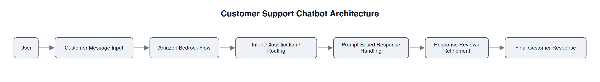

# Customer Support Chatbot with Amazon Bedrock Flows

An AI customer support chatbot built with Amazon Bedrock Flows, showcasing multi-step prompt workflows, intent-based routing, response generation, and iterative refinement.

## Overview

This project demonstrates how Amazon Bedrock Flows can be used to build a prompt-driven customer support chatbot. The workflow is designed to process customer messages, identify intent, route requests appropriately, generate responses, and refine those responses before returning them to the user.

The chatbot is structured as a multi-step flow rather than a single prompt, allowing the system to handle customer support interactions in a more organized and reliable way.

## Architecture and Workflow

The architecture follows a prompt-driven workflow:

- **User**: The workflow begins when a customer submits a support request or question.
- **Customer Message Input**: The customer’s message is captured as the input to the chatbot workflow.
- **Amazon Bedrock Flow**: The request is processed through Amazon Bedrock Flows, which manages the sequence of prompt-driven steps.
- **Intent Classification / Routing**: The workflow determines the type of request and routes it to the appropriate handling path based on the prompt design.
- **Prompt-Based Response Handling**: The system generates a response according to the identified request type, using the prompt instructions to guide behavior.
- **Response Review / Refinement**: The generated response is refined to improve clarity, relevance, and consistency before being returned.
- **Final Customer Response**: The chatbot delivers the completed response back to the customer.

## My Contributions

In this project, I:
- Built and refined the prompt-driven customer support workflow
- Designed routing behavior for different types of customer requests
- Improved response quality through prompt iteration and testing
- Reviewed outputs to identify areas for improvement
- Documented the workflow design and key implementation decisions

## Key Findings

This project strengthened my understanding of prompt workflows, response refinement, and intent-based routing in Amazon Bedrock Flows. It also showed how multi-step prompt design can improve consistency and quality in customer-facing AI systems.
